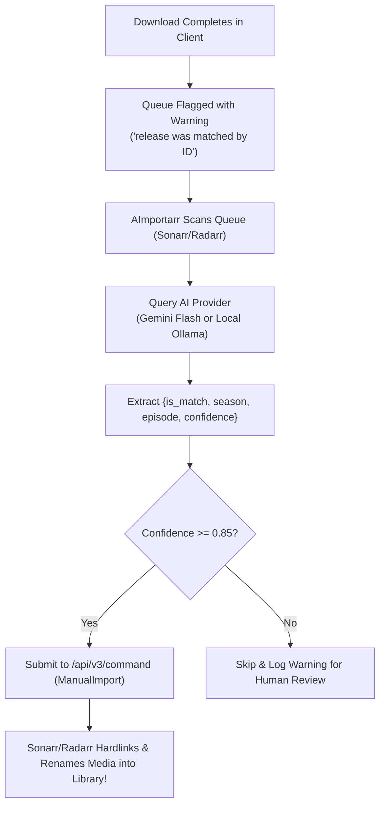

# AImportarr 🤖🎬

**AImportarr** is an AI-powered media matching and automated importer microservice for the `*arr` ecosystem (**Sonarr** & **Radarr**). 

It specifically bridges the gap for **international and multilingual media releases** where non-standard filenames, Chinese Pinyin, Romaji, and unorthodox directory packaging trip up Sonarr and Radarr's built-in regex parsers.

---

## 🚀 Features

- **Automated Rescue for ID-Matched Blocks**: Automatically clears and approves releases blocked by Sonarr and Radarr's safety warning:
  > *"Found matching series/movie via grab history, but release was matched to series/movie by ID. Automatic import is not possible."*
- **Semantic Episode Identification (Sonarr)**: Uses LLM intelligence to deduce season and episode numbers from ambiguous filenames (e.g. `[Group] 05.mkv`, `第01集.mkv`, `EP02-03.mp4`, or nested episode folders).
- **Movie Matching & Year Reconciliation (Radarr)**: Accurately identifies foreign movie titles, Pinyin releases, and handles ±1 year release discrepancies between film festivals and theatrical debuts.
- **Dual AI Provider Support**:
  - **Google Gemini API**: Free tier, blazing fast (~300ms), world-class multilingual parsing for Chinese, Japanese, and Korean releases. Zero server CPU/VRAM footprint.
  - **Local Ollama**: 100% private and offline inference on your own hardware using models like `qwen2.5:3b`, `qwen2.5:7b`, or `llama3.2`.
- **Zero-Touch API Integration**: Connects via Sonarr and Radarr's official REST API (`/api/v3/queue` and `/api/v3/command` `ManualImport`).
- **Safety First**:
  - `dry_run` mode allows you to simulate and inspect matches before committing imports.
  - `min_confidence` threshold prevents low-confidence hallucinated imports.
- **Ultra-Lightweight**: Packaged in Python 3.12 slim (~80MB image, ~35MB RAM footprint).

---

## 🛠️ Quick Start

### 1. Configure
Copy the example configuration file:
```bash
cp config.example.yml config.yml
```

Edit `config.yml` with your Sonarr/Radarr details and preferred AI provider:
```yaml
general:
  dry_run: false
  check_interval_seconds: 120
  min_confidence: 0.85

ai:
  provider: "gemini" # or "ollama"
  
  gemini:
    api_key: "YOUR_GOOGLE_AI_STUDIO_API_KEY"
    model: "gemini-2.0-flash"

  ollama:
    base_url: "http://localhost:11434"
    model: "qwen2.5:3b"

sonarr:
  enabled: true
  url: "http://localhost:8989"
  api_key: "YOUR_SONARR_API_KEY"

radarr:
  enabled: false
  url: "http://localhost:7878"
  api_key: "YOUR_RADARR_API_KEY"
```

### 2. Run with Docker Compose
```bash
docker compose up -d
```

### 3. Run Locally with Python (Dev mode)
```bash
python3 -m venv venv
source venv/bin/activate
pip install -r requirements.txt
python -m src.main
```

---

## 🐳 Unraid Deployment

To run AImportarr on Unraid:
1. Copy or clone the `aimportarr` folder to `/mnt/user/appdata/aimportarr`.
2. Build or run the container via Docker Compose or add a custom template in the Unraid Docker tab pointing to `/config` mapped to `/mnt/user/appdata/aimportarr/config`.

---

## ⚙️ How It Works Under the Hood



---

## 📄 License
MIT License. See [LICENSE](LICENSE) for details.
