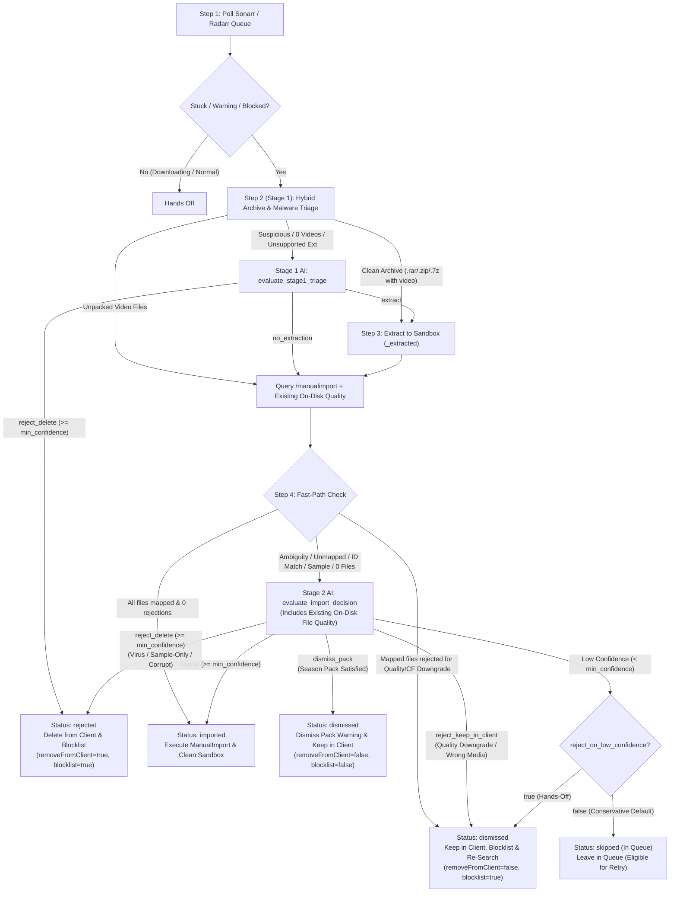

# AImportarr Architecture & Two-Stage AI Evaluation Design

AImportarr is an autonomous queue companion for **Sonarr** and **Radarr**. It monitors your download queues for stuck, blocked, or warning items and resolves them using a **4-step, two-stage hybrid pipeline** that combines Sonarr/Radarr's native parser and quality engine with AI reasoning (Google Gemini and/or local Ollama).

---

## Core Design Principles

1. **Sonarr & Radarr First (Zero-Token Fast Paths)**
   - AImportarr never overrides healthy downloads that Sonarr/Radarr are already importing normally.
   - Clean archives (`.rar`, `.zip`, `.7z`, `.tar` containing video files and zero suspicious files) are unpacked into an isolated `<stem>_extracted` sandbox and passed back to Sonarr/Radarr's `/api/v3/manualimport` endpoint—using **0 AI tokens** when Sonarr/Radarr can map the unpacked video cleanly.

2. **Strict Client File Preservation & Deletion Policy**
   - **Rejected (`removeFromClient=true`, `blocklist=true`, `skipRedownload=false`)**: Files are deleted from the download client **only** when confirmed to be **virus/malware, sample-only, or corrupt/unusable**.
   - **Dismissed (`removeFromClient=false`, `blocklist=true`, `skipRedownload=false`)**: Used for **quality/Custom Format downgrades** and **wrong/mismatched media**. The item is removed from the Sonarr/Radarr queue, blocklisted, and re-searched natively via `skipRedownload=false`, while files **remain intact** in your download client.
   - **Dismissed Season Pack (`removeFromClient=false`, `blocklist=false`, `skipRedownload=true`)**: Used when a season pack's needed episodes have been imported and remaining files are already satisfied on disk. Clears the queue warning while keeping the release in your download client.

3. **Dual Quality & Upgrade Enforcement**
   - Before importing any file, AImportarr checks both Sonarr/Radarr's native quality/Custom Format rejections **and** fetches existing on-disk file metadata (`episodefile` / `movieFile`) so Stage 2 AI can verify whether newly mapped episodes or movies are genuine upgrades or downgrades.

4. **Configurable Low-Confidence Policy (`reject_on_low_confidence`)**
   - **Conservative Mode (`false`, default)**: If AI confidence is below `min_confidence`, the item is left untouched in the queue (`skipped` status, shown under the **In Queue** filter) and can be retried from the Web UI.
   - **Hands-Off Mode (`true`)**: If AI confidence is below `min_confidence`, the release is automatically dismissed and blocklisted while keeping files in the download client (`removeFromClient=false, blocklist=true, skipRedownload=false`). High confidence (`>= min_confidence`) is still strictly required to import media or delete files from the download client.

---

## 4-Step Pipeline Flowchart

---

## Detailed Walkthrough of the 4 Steps

### Step 1: Event-Driven Discovery & Throttled FIFO Queue
AImportarr decouples **queue discovery** from **item processing** via a deduplicated `asyncio.Queue` (FIFO):
- **Instant Triggers (0s Wait)**:
  - **Sonarr/Radarr Webhooks (`POST /api/webhook`)**: Configure a Webhook in Sonarr/Radarr (*Settings → Connect → Webhook*) pointing to `http://<aimportarr-ip>:9890/api/webhook` to wake AImportarr the moment an import stalls.
  - **UI Retry & Scan Now (`POST /api/retry`, `POST /api/scan`)**: Clicking **🔄 Retry**, **Retry All In Queue**, or **⚡ Scan Now** immediately wakes the discovery loop and enqueues eligible items.
  - **Lightweight Local Sync (`check_interval_seconds: 30`)**: Periodically checks `GET /api/v3/queue` over the LAN (0 AI tokens), filtering out downloading or already-resolved SQLite items via `is_item_eligible()` before touching the FIFO queue.
- **Single-Worker FIFO Consumer & AI Rate-Limiter**:
  - Processes one release at a time in FIFO order so multiple archive extractions never compete for disk I/O.
  - Fast-path items (0 AI tokens) run with **zero artificial delay**, while items that actually invoke Gemini/Ollama enforce `ai_cooldown_seconds` (default `4.0s`) before the next item runs to prevent HTTP 429 rate-limit bursts.

### Step 2 (Stage 1): Archive & Malware Triage
AImportarr inspects the local download directory (resolving `path_mappings` if configured):
- **Fast-Path Unpacked**: If video files are already unpacked and no archives or suspicious extensions (`.exe`, `.scr`, `.bat`, `.vbs`, `.msi`, `.ps1`, `.lnk`, `.iso`) exist, Stage 1 AI is skipped.
- **Fast-Path Clean Archive**: If an archive (`.rar`, `.zip`, `.7z`, `.tar`) is found, `inspect_archive()` reads its header table in memory without extracting to disk. If it contains video files and zero suspicious files, it proceeds directly to Step 3 sandbox extraction (0 AI tokens).
- **Stage 1 AI (`evaluate_stage1_triage`)**: Triggered only when an archive contains suspicious files or 0 video streams, when loose suspicious files exist on disk, or when `/manualimport` finds 0 importable files.
  - Returns `extract`, `no_extraction`, or `reject_delete` (malware, corrupt, or sample-only).

### Step 3: Sandbox Extraction & Automatic Cleanup
When extraction is needed:
- Extracts only valid files into `<download_dir>/<archive_stem>_extracted` with strict path-traversal (Zip-Slip) validation.
- In a `finally` block after Step 4 finishes, the temporary `_extracted` staging folder is deleted (`shutil.rmtree`) so disk space is never duplicated and the original archive remains untouched.

### Step 4 (Stage 2): `/manualimport` Fast-Path & Stage 2 AI Decision
AImportarr queries `GET /api/v3/manualimport` (pointing at the sandbox folder if extracted, or the download folder otherwise) and retrieves existing on-disk file metadata (`episodefile` / `movieFile`):
1. **Fast-Path A — Hard Quality Rejection (0 AI Tokens)**:
   - If Sonarr/Radarr mapped the target episodes/movie and rejected every candidate file due to quality cutoff or Custom Format score downgrade, AImportarr immediately records `status="dismissed"` (`category="quality_downgrade"`) and calls `DELETE /api/v3/queue/{id}?removeFromClient=false&blocklist=true&skipRedownload=false`.
2. **Fast-Path B — Clean Match (0 AI Tokens)**:
   - If all candidate video files are cleanly mapped with 0 rejections (common right after extracting a scene `.rar`), AImportarr immediately triggers the `ManualImport` command and records `status="imported"`.
3. **Stage 2 AI (`evaluate_import_decision`)**:
   - Invoked when ambiguity remains (`id_match`, `unknown_media`, `unknown_episode`, `sample_or_extra`, or partial season packs).
   - Evaluates candidate files, library candidates, episode lists, and existing on-disk quality to return one of:
     - `import` — Maps exact `seriesId`/`movieId` and `episodeIds` and executes `ManualImport`.
     - `reject_keep_in_client` — Quality downgrade or wrong media (`status="dismissed"`, keeps files in client, blocklists, and triggers re-search).
     - `reject_delete` — Confirmed virus/malware, sample-only, or corrupt release (`status="rejected"`, deletes from download client and blocklists).
     - `dismiss_pack` — Season pack whose remaining files are already on disk (`status="dismissed"`, removes queue warning while keeping files in client).

---

## Statuses, Filters, and Retry Lifecycle

| Status | Meaning | Download Client | *arr Queue | Retryable in UI? | UI Filter Pill |
| :--- | :--- | :--- | :--- | :--- | :--- |
| **`imported`** | Imported into media library | Untouched | Imported & removed | No | `Imported` |
| **`dismissed`** | Ignored (quality downgrade, wrong media, or satisfied pack) | Untouched (kept in client) | Removed (and blocklisted if bad match/downgrade) | No | `Dismissed` |
| **`rejected`** | Malware, sample-only, or corrupt release | **Deleted from client** | Removed & blocklisted | No | `Rejected` |
| **`skipped`** | Left in queue (low AI confidence or unmounted path) | Untouched | Still in queue | **Yes (`🔄 Retry`)** | `In Queue` |
| **`failed`** | Manual import API call failed | Untouched | Still in queue | **Yes (`🔄 Retry`)** | `In Queue` |
| **`dry_run`** | Simulated decision (`general.dry_run: true`) | Untouched | Still in queue | **Yes (`🔄 Retry`)** | `In Queue` |

When an `In Queue` item is retried and re-evaluated on the next scan cycle, its previous row in SQLite (`processed_items`) is replaced by the new result so stale retry rows never accumulate.

---

## Component Map

- [`src/main.py`](../src/main.py): Async polling loop, hot-reload callback handler, and startup initialization.
- [`src/config.py`](../src/config.py): Pydantic configuration models, YAML loader/saver, and environment variable overrides.
- [`src/sonarr.py`](../src/sonarr.py) & [`src/radarr.py`](../src/radarr.py): *arr REST API clients and the 4-step queue processing state machine.
- [`src/extractor.py`](../src/extractor.py): In-memory archive header inspector (`7z l -slt`) and Zip-Slip-safe sandbox extractor.
- [`src/ai/`](../src/ai/):
  - [`base.py`](../src/ai/base.py): `AIProvider` interface, `Stage1TriageResult`, and `Stage2DecisionResult` schemas.
  - [`gemini.py`](../src/ai/gemini.py): Google Gemini provider with automatic fastest-model discovery and 404 self-healing.
  - [`ollama.py`](../src/ai/ollama.py): Local Ollama JSON-schema provider.
  - [`fallback.py`](../src/ai/fallback.py): Automatic failover wrapper between primary and secondary AI providers.
- [`src/database.py`](../src/database.py) & [`src/metrics.py`](../src/metrics.py): SQLite WAL persistence, retention purging, token analytics, and retry state management.
- [`src/web.py`](../src/web.py): Zero-dependency embedded Web UI dashboard and REST API (`/api/metrics`, `/api/history`, `/api/tokens`, `/api/retry`, `/api/config`).
