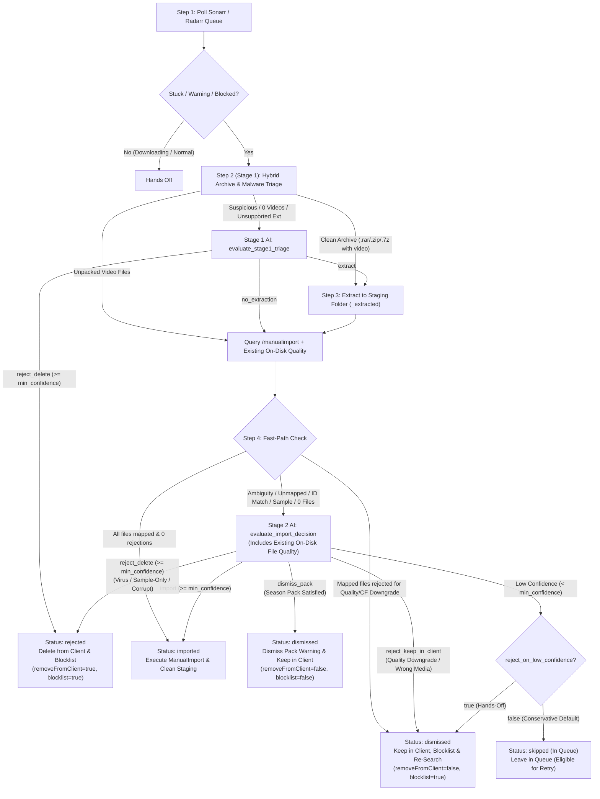
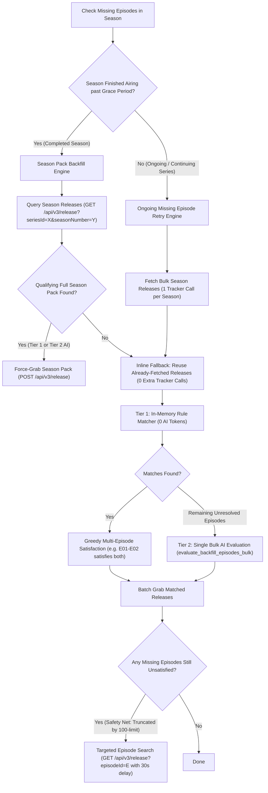

# AImportarr Architecture & Two-Stage AI Evaluation Design

AImportarr is an autonomous queue companion for **Sonarr** and **Radarr**. It monitors your download queues for stuck, blocked, or warning items and resolves them using a **4-step, two-stage hybrid pipeline** that combines Sonarr/Radarr's native parser and quality engine with AI reasoning (Google Gemini and/or local Ollama).

---

## Core Design Principles

1. **Sonarr & Radarr First (Zero-Token Fast Paths)**
   - AImportarr never overrides healthy downloads that Sonarr/Radarr are already importing normally.
   - Clean archives (`.rar`, `.zip`, `.7z`, `.tar` containing video files) are unpacked into a temporary `<stem>_extracted` staging folder and passed back to Sonarr/Radarr's `/api/v3/manualimport` endpoint—using **0 AI tokens** when Sonarr/Radarr can map the unpacked video cleanly.

2. **Strict Client File Preservation & Deletion Policy**
   - **Rejected (`removeFromClient=true`, `blocklist=true`, `skipRedownload=false`)**: Files are deleted from the download client **only** when confirmed to be **virus/malware, sample-only, or corrupt/unusable**.
   - **Dismissed (`removeFromClient=false`, `blocklist=true`, `skipRedownload=false`)**: Used for **quality/Custom Format downgrades** and **wrong/mismatched media**. The item is removed from the Sonarr/Radarr queue, blocklisted, and re-searched natively via `skipRedownload=false`, while files **remain intact** in your download client.
   - **Dismissed Season Pack (`removeFromClient=false`, `blocklist=false`, `skipRedownload=true`)**: Used when a season pack's needed episodes have been imported and remaining files are already satisfied on disk. Clears the queue warning while keeping the release in your download client.

3. **Dual Quality & Upgrade Enforcement**
   - Before importing any file, AImportarr checks both Sonarr/Radarr's native quality/Custom Format rejections **and** fetches existing on-disk file metadata (`episodefile` / `movieFile`) so Stage 2 AI can verify whether newly mapped episodes or movies are genuine upgrades or downgrades.

4. **Configurable Low-Confidence Policy (`reject_on_low_confidence`)**
   - **Conservative Mode (`false`, default)**: If AI confidence is below `min_confidence`, the item is left untouched in the queue (`skipped` status, shown under the **In Queue** filter) and can be retried from the Web UI.
   - **Hands-Off Mode (`true`)**: If AI confidence is below `min_confidence`, the release is automatically dismissed and blocklisted while keeping files in the download client (`removeFromClient=false, blocklist=true, skipRedownload=false`). High confidence (`>= min_confidence`) is still strictly required to import media or delete files from the download client.

---

## 4-Step Pipeline Flowchart

---

## Detailed Walkthrough of the 4 Steps

### Step 1: Event-Driven Discovery & Throttled FIFO Queue
AImportarr decouples **queue discovery** from **item processing** via a deduplicated `asyncio.Queue` (FIFO):
- **Instant Triggers (0s Wait)**:
  - **Sonarr/Radarr Webhooks (`POST /api/webhook`)**: Configure a Webhook in Sonarr/Radarr (*Settings → Connect → + → Webhook*, Method: `POST`) pointing to `http://<aimportarr-ip>:9890/api/webhook` with **On Manual Interaction Required** enabled in both apps (and **On Import Complete** enabled in Sonarr for partial season packs) to wake AImportarr the moment an import stalls.
  - **UI Retry & Scan Now (`POST /api/retry`, `POST /api/scan`)**: Clicking **🔄 Retry**, **Retry All In Queue**, or **⚡ Scan Now** immediately wakes the discovery loop and enqueues eligible items.
  - **Lightweight Local Sync (`check_interval_seconds: 30`)**: Periodically checks `GET /api/v3/queue` over the LAN (0 AI tokens), filtering out downloading or already-resolved SQLite items via `is_item_eligible()` before touching the FIFO queue.
- **Single-Worker FIFO Consumer & AI Rate-Limiter**:
  - Processes one release at a time in FIFO order so multiple archive extractions never compete for disk I/O.
  - Fast-path items (0 AI tokens) run with **zero artificial delay**, while items that actually invoke Gemini/Ollama enforce `ai_cooldown_seconds` (default `4.0s`) before the next item runs to prevent HTTP 429 rate-limit bursts.

### Step 2 (Stage 1): Archive & Malware Triage
AImportarr inspects the local download directory (resolving `path_mappings` if configured):
- **Fast-Path Unpacked**: If video files are already unpacked and no archives or suspicious extensions (`.exe`, `.scr`, `.bat`, `.vbs`, `.msi`, `.ps1`, `.lnk`, `.iso`) exist, Stage 1 AI is skipped.
- **Fast-Path Clean Archive**: If an archive (`.rar`, `.zip`, `.7z`, `.tar`) is found, `inspect_archive()` reads its header table without extracting to disk. If it contains video files and zero suspicious files, it proceeds directly to Step 3 staging extraction (0 AI tokens).
- **Stage 1 AI (`evaluate_stage1_triage`)**: Triggered only when an archive contains suspicious files or 0 video streams, when loose suspicious files exist on disk, or when `/manualimport` finds 0 importable files.
  - Returns `extract`, `no_extraction`, or `reject_delete` (malware, corrupt, or sample-only).

### Step 3: Temporary Staging Extraction & Automatic Cleanup
When extraction is needed:
- Extracts video and subtitle files into `<download_dir>/<archive_stem>_extracted`.
- In a `finally` block after Step 4 finishes, the temporary `_extracted` staging folder is deleted (`shutil.rmtree`) so disk space is never duplicated and the original archive remains untouched.

### Step 4 (Stage 2): `/manualimport` Fast-Path & Stage 2 AI Decision
AImportarr queries `GET /api/v3/manualimport` (pointing at the staging folder if extracted, or the download folder otherwise) and retrieves existing on-disk file metadata (`episodefile` / `movieFile`):
1. **Fast-Path A — Hard Quality Rejection (0 AI Tokens)**:
   - If Sonarr/Radarr mapped the target episodes/movie and rejected every candidate file due to quality cutoff or Custom Format score downgrade, AImportarr immediately records `status="dismissed"` (`category="quality_downgrade"`) and calls `DELETE /api/v3/queue/{id}?removeFromClient=false&blocklist=true&skipRedownload=false`.
2. **Fast-Path B — Clean Match (0 AI Tokens)**:
   - If all candidate video files are cleanly mapped with 0 rejections (common right after extracting a scene `.rar`), AImportarr immediately triggers the `ManualImport` command and records `status="imported"`.
3. **Stage 2 AI (`evaluate_import_decision`)**:
   - Invoked when ambiguity remains (`id_match`, `unknown_media`, `unknown_episode`, `sample_or_extra`, or partial season packs).
   - Evaluates candidate files, library candidates, episode lists, and existing on-disk quality to return one of:
     - `import` — Maps exact `seriesId`/`movieId` and `episodeIds` and executes `ManualImport`.
     - `reject_keep_in_client` — Quality downgrade or wrong media (`status="dismissed"`, keeps files in client, blocklists, and triggers re-search).
     - `reject_delete` — Confirmed virus/malware, sample-only, or corrupt release (`status="rejected"`, deletes from download client and blocklists).
     - `dismiss_pack` — Season pack whose remaining files are already on disk (`status="dismissed"`, removes queue warning while keeping files in client).

---

## Sonarr Season Pack Backfill & Ongoing Season Episode Retry

Beyond stuck queue processing, AImportarr features autonomous background engines for resolving missing episodes across both completed and actively broadcasting seasons:

### 1. Completed Seasons: Season Pack Backfill
- **Eligibility**: Verified via `is_season_eligible_for_backfill()`. All monitored episodes must have aired at least `min_missing_days` ago (default: 3 days), at least 1 monitored episode must be missing (`hasFile == False`), and the season must not be the latest season of an actively continuing series.
- **Two-Tier Pack Classification**:
  - **Tier 1 (0 AI Tokens)**: Approves `fullSeason: true` packs with zero non-quality rejections (tolerates equal/higher quality existing files on disk), sorted by Custom Format score and seeders.
  - **Tier 2 (AI Fallback)**: Evaluates `fullSeason: true` packs whose only non-quality rejection is `"Unknown Series"` (common with foreign, Pinyin, or non-standard indexer naming).
- **Inline Fallback**: If 0 qualifying full season packs exist, AImportarr immediately falls back inline in the same run to match individual missing episodes using the **already-fetched release pool—requiring zero additional tracker queries**.

### 2. Ongoing Seasons: Missing Episode Retry Engine
- **Ongoing Season Detection**: A season is treated as ongoing if it has future or TBA air dates, or if it is the latest season of a series with `status == "continuing"` or `"upcoming"`.
- **Bulk Season-Level Search (1 Tracker Query)**: Instead of querying trackers once for each missing episode ($N$ queries with rate-limiting pauses), AImportarr hits `GET /api/v3/release?seriesId=X&seasonNumber=Y` once per season. This reduces tracker query volume by **80–90%** and eliminates rate-limiting delays between episodes of the same season.
- **Tier 1 In-Memory Matching (0 AI Tokens)**: Matches clean single and multi-episode releases directly from the season pool using Sonarr's metadata, quality weights, and Custom Format scores.
- **Greedy Multi-Episode Satisfaction**: When a grabbed release covers multiple episodes (e.g. `S01E02-E03`), all covered episodes are immediately satisfied and recorded in processed history, skipping redundant searches and downloads.
- **Quality Rejection Tolerance**: Single and multi-episode releases rejected only for existing-file quality on an already-downloaded companion episode are accepted as Tier 1, since AImportarr skips the existing files while importing the missing ones.
- **Tier 2 Single Bulk AI Evaluation**: If any missing episodes remain unresolved (e.g., Pinyin / Chinese / non-standard naming), AImportarr evaluates them against candidate releases in a **single bulk AI prompt** (`evaluate_backfill_episodes_bulk`).
- **Immediate Targeted Fallback (Safety Net)**: If an older episode was pushed out of the 100-result season pool by indexer pagination, AImportarr immediately falls back to a targeted `GET /api/v3/release?episodeId=E` search with a strict **30-second delay** between targeted calls to protect indexers.

---

## Statuses, Filters, and Retry Lifecycle

| Status | Meaning | Download Client | *arr Queue | Retryable in UI? | UI Filter Pill |
| :--- | :--- | :--- | :--- | :--- | :--- |
| **`imported`** | Imported into media library | Untouched | Imported & removed | No | `Imported` |
| **`dismissed`** | Ignored (quality downgrade, wrong media, or satisfied pack) | Untouched (kept in client) | Removed (and blocklisted if bad match/downgrade) | No | `Dismissed` |
| **`rejected`** | Malware, sample-only, or corrupt release | **Deleted from client** | Removed & blocklisted | No | `Rejected` |
| **`skipped`** | Left in queue (low AI confidence or unmounted path) | Untouched | Still in queue | **Yes (`🔄 Retry`)** | `In Queue` |
| **`failed`** | Manual import API call failed | Untouched | Still in queue | **Yes (`🔄 Retry`)** | `In Queue` |
| **`dry_run`** | Simulated decision (`general.dry_run: true`) | Untouched | Still in queue | **Yes (`🔄 Retry`)** | `In Queue` |

When an `In Queue` item is retried and re-evaluated on the next scan cycle, its previous row in SQLite (`processed_items`) is replaced by the new result so stale retry rows never accumulate.

---

## Configuration & Environment Variables

All settings can be configured in `/config/config.yml` (see [`config.example.yml`](../config.example.yml)), via the **⚙️ Settings** Web UI tab (hot-reloaded immediately), or overridden with environment variables:

| Setting | Env Variable | Default | Description |
| :--- | :--- | :--- | :--- |
| `general.dry_run` | `DRY_RUN` | `false` | Simulate all decisions without modifying *arr or deleting files. |
| `general.check_interval_seconds` | `CHECK_INTERVAL_SECONDS` | `30` | Lightweight local *arr queue check interval in seconds (0 AI tokens). Webhooks & Retry trigger immediately. |
| `general.ai_cooldown_seconds` | `AI_COOLDOWN_SECONDS` | `4.0` | Minimum cooldown in seconds between AI model calls in the FIFO worker to prevent rate-limit bursts. |
| `general.min_confidence` | `MIN_CONFIDENCE` | `0.85` | Minimum AI confidence required (`0.0`–`1.0`) to import or delete files. |
| `general.reject_on_low_confidence` | `REJECT_ON_LOW_CONFIDENCE` | `false` | `false` leaves low-confidence items in queue (`In Queue`); `true` dismisses & blocklists while keeping files in client. |
| `general.log_level` | `LOG_LEVEL` | `INFO` | Logging verbosity (`DEBUG`, `INFO`, `WARNING`, `ERROR`). |
| `ai.provider` | `AI_PROVIDER` | `gemini` | Primary AI backend (`gemini` or `ollama`). |
| `ai.fallback_enabled` | `AI_FALLBACK_ENABLED` | `true` | Automatically fail over to secondary provider on rate limits or errors. |
| `ai.gemini.api_key` | `GEMINI_API_KEY` | `""` | Google Gemini API key. |
| `ai.gemini.model` | `GEMINI_MODEL` | `auto` | Gemini model name (`auto` resolves fastest active Flash model). |
| `ai.ollama.base_url` | `OLLAMA_BASE_URL` | `http://localhost:11434` | Ollama server URL. |
| `ai.ollama.model` | `OLLAMA_MODEL` | `qwen2.5:1.5b` | Ollama model tag. |
| `sonarr.enabled` / `url` / `api_key` | `SONARR_ENABLED`, `SONARR_URL`, `SONARR_API_KEY` | — | Sonarr connection settings. |
| `sonarr.season_pack_backfill.enabled` | `SONARR_BACKFILL_ENABLED` | `false` | Opt-in: search and force-grab Season Packs for completed seasons with missing episodes when Sonarr rejects the pack solely because other episodes on disk have higher quality. |
| `sonarr.season_pack_backfill.interval_hours` | `SONARR_BACKFILL_INTERVAL_HOURS` | `12` | Background check interval in hours for Season Pack Backfill. |
| `sonarr.season_pack_backfill.min_missing_days` | `SONARR_BACKFILL_MIN_MISSING_DAYS` | `3` | Post-finale grace period in days after the season's last episode airs before backfilling with a season pack. |
| `sonarr.season_pack_backfill.max_seasons_per_run` | `SONARR_BACKFILL_MAX_SEASONS_PER_RUN` | `3` | Maximum seasons queried via interactive search per backfill run. |
| `sonarr.season_pack_backfill.season_cooldown_days` | `SONARR_BACKFILL_COOLDOWN_DAYS` | `7` | Per-season cooldown in days before re-searching the same season (resettable via UI Retry). |
| `sonarr.missing_episode_retry.enabled` | `SONARR_EPISODE_RETRY_ENABLED` | `false` | Opt-in: periodically retry individual missing aired episodes for ongoing/incomplete seasons using bulk season search and single bulk AI evaluation. |
| `sonarr.missing_episode_retry.interval_hours` | `SONARR_EPISODE_RETRY_INTERVAL_HOURS` | `6` | Background check interval in hours for ongoing missing episode retries. |
| `sonarr.missing_episode_retry.min_air_delay_hours` | `SONARR_EPISODE_RETRY_MIN_AIR_DELAY_HOURS` | `6` | Minimum delay in hours after an episode's broadcast air time before attempting interactive search. |
| `sonarr.missing_episode_retry.max_episodes_per_run` | `SONARR_EPISODE_RETRY_MAX_EPISODES_PER_RUN` | `5` | Maximum number of episodes queried via targeted fallback search per run. |
| `sonarr.missing_episode_retry.episode_cooldown_hours` | `SONARR_EPISODE_RETRY_COOLDOWN_HOURS` | `24` | Cooldown in hours before re-attempting search for an unfulfilled episode release. |
| `radarr.enabled` / `url` / `api_key` | `RADARR_ENABLED`, `RADARR_URL`, `RADARR_API_KEY` | — | Radarr connection settings. |
| `extraction.enabled` | `EXTRACTION_ENABLED` | `true` | Enable archive inspection & staging extraction. |
| `extraction.delete_after_import` | `EXTRACTION_DELETE_AFTER_IMPORT` | `true` | Clean up extracted staging folder once imported. |
| `extraction.staging_suffix` | `EXTRACTION_STAGING_SUFFIX` | `_extracted` | Suffix for temporary staging extraction directories. |
| `web.enabled` / `host` / `port` | `WEB_ENABLED`, `WEB_HOST`, `WEB_PORT` | `true` (`0.0.0.0:9890`) | Embedded Web UI and REST API server settings. |
| `database.path` / `retention_days` | `DATABASE_PATH`, `DATABASE_RETENTION_DAYS` | `/config/aimportarr.db` (`30`d) | SQLite database path and history retention period. |

---

## Component Map

- [`src/main.py`](../src/main.py): Async queue polling worker, backfill worker, ongoing episode retry scheduler, hot-reload callback handler, and startup initialization.
- [`src/config.py`](../src/config.py): Pydantic configuration models, YAML loader/saver, and environment variable overrides.
- [`src/sonarr.py`](../src/sonarr.py) & [`src/radarr.py`](../src/radarr.py): *arr REST API clients, the 4-step queue processing state machine, Season Pack Backfill, and Bulk Missing Episode Retry engines.
- [`src/extractor.py`](../src/extractor.py): Archive header inspector (`7z l -slt`) and staging folder extractor.
- [`src/ai/`](../src/ai/):
  - [`base.py`](../src/ai/base.py): `AIProvider` interface, `Stage1TriageResult`, `Stage2DecisionResult`, `BackfillPackMatchResult`, and `BackfillBulkEpisodesMatchResult` schemas.
  - [`gemini.py`](../src/ai/gemini.py): Google Gemini provider with automatic fastest-model discovery, 404 self-healing, and bulk episode matching.
  - [`ollama.py`](../src/ai/ollama.py): Local Ollama JSON-schema provider with bulk episode matching.
  - [`fallback.py`](../src/ai/fallback.py): Automatic failover wrapper between primary and secondary AI providers.
- [`src/database.py`](../src/database.py) & [`src/metrics.py`](../src/metrics.py): SQLite WAL persistence, retention purging, token analytics, cooldown tracking, and retry state management.
- [`src/web.py`](../src/web.py): Zero-dependency embedded Web UI dashboard and REST API (`/api/metrics`, `/api/history`, `/api/tokens`, `/api/retry`, `/api/backfill`, `/api/episode-retry`, `/api/config`).
